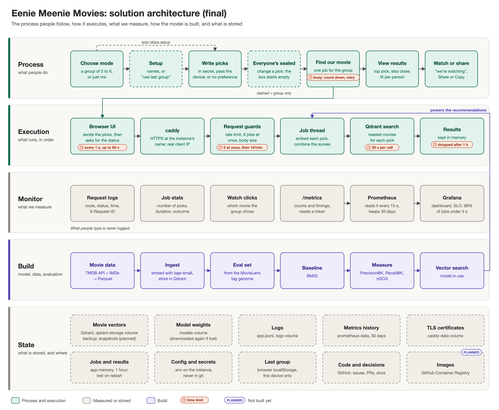
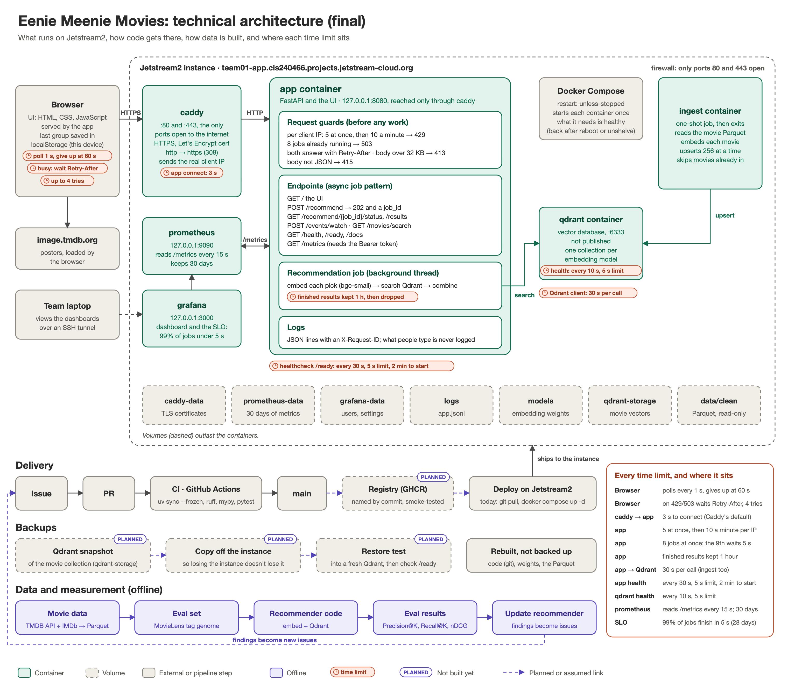

# movierec: architecture (final)

*Final Project Deliverable 3.* Revised from the Deliverable 2 diagrams ([ARCHITECTURE.md](ARCHITECTURE.md), kept
as they were) to show the system we built: the reverse proxy, monitoring, the registry, the backups, and where each
time limit sits. Boxes marked **PLANNED** are not built yet.

## Solution architecture

The process people follow, how it executes, what we measure, how the model is built, and what is stored.



## Technical architecture

What runs on Jetstream2, how code gets there, the backups, and every time limit.



## Editing the diagrams

Both are drawn by [`diagrams/architecture_final.py`](diagrams/architecture_final.py). Change the boxes there and run,
from the repository root:

```bash
uv run --no-project --with playwright python docs/diagrams/architecture_final.py
```
