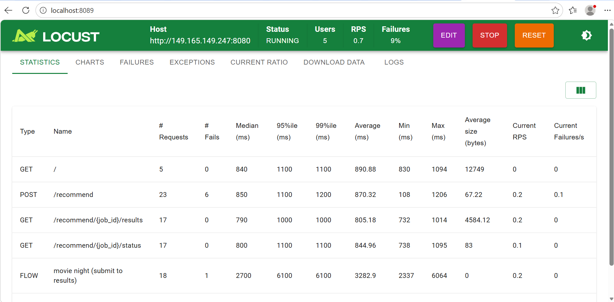
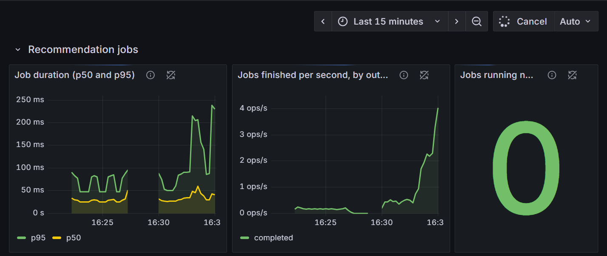

# discussion

**❏ Start with your user and their problem. What problem does the application solve?**

- *Who is the user?:* The primary target consists of a group of people, whether that's friends, coworkers, family, acquaintances, or even strangers, looking for a movie recommendation and the secondary target is individuals who don't know exactly what they're in the mood for. 

- *What is their problem?* They might know the general feeling they want but can't land on a specific film. Our app will give each person an equal say in group settings and ease a lot of personal stress in individual ones.

**❏ Walk us through your architecture diagram, keeping the technical detail at the level your audience needs: enough to understand your choices without going deep into a rabbit hole.**

- TODO

**❏ As appropriate, discuss your baseline, your improvements, and how you measured success.**

- TODO

**❏ Share a few findings from your Homework 3 testers and what you did about each.**

- TODO

**❏ Tell a story that demonstrates your careful decision making critical thinking that motivated your choices throughout, from selecting a problem, to one attempt at resolving some of its key challenges, to the lessons learned along the way.**

- TODO

**❏ Describe how Kubernetes could be used in your applications but don’t actually implement it. Describe what would break if two copies of your application ran behind the same address (anything kept in one process’s memory, such as jobs, sessions, or caches) and how you would move that state out of the process.**

- Kubernetes would be a useful implementation in the application to ensure efficient resource utilization, but the current job dictionary, rate limits, and jobs-in-flight cap require changes. Presently, recommendation job IDs are stored as an in-memory dictionary. The IDs themselves are logged, but they are not stored in a docker volume for persistent lookup across copies. POST /recommend would land on copy A’s memory, and copy B would answer a status poll with 404. A solution would be to store jobs in Redis, with each job's status and result under its id and an expiry to replace the one-hour cleanup. Additionally, variables like the RateLimiter and Jobs-in-Flight would live in each copy’s buckets, so they would effectively become multiplied with additional copies. This issue could also be mitigated by keeping counters and running jobs in Redis.

**❏ Write one service level objective for your main route: what counts as a good request, the share of requests that must be good, and so on.**

- People use Eenie Meenie Movies to get a recommendation: `POST /recommend` starts a job, and the page polls until the job is done. What a person waits for is the **job**, so the SLO is about jobs, not about the `POST` (which answers in milliseconds).

> Over any 28 days, 99% of recommendations complete within 5 seconds.

**❏ Run a Locust load test by creating a locustfile.py with user behavior.**

- `loadtest/locustfile.py` behaves like one group using the web page. It loads the page, submits 1 to 6 descriptions, waits out `Retry-After` up to four times if the server is busy, polls the job every second for up to a minute, and reads the results. It then waits 10 to 30 seconds and starts again. Every request id starts with `locust-`, so load-test traffic can be filtered out of the logs, and the simulated users never tap "We're watching", so the usage numbers stay real. Locust was run from a laptop and Grafana watched at the same time: Locust shows what users experienced, and Grafana shows what the server did.

- *Test 1, 5 users:* Locust ran 5 users for 2.5min (146 requests). All simulated users shared the laptop's address, so the server saw them as one person asking about 15 times a minute against a limit of 10 a minute (burst of 5). As a result, 18 of 51 submissions got a 429 with a `Retry-After` of 1 to 5 seconds. The users waited and tried again, and 29 of 32 recommendations completed. Because of those waits, a full recommendation took a median of 2.9s but up to 12s at the 95th percentile. This confirmed the rate limit holds and that clients can recover by following `Retry-After`. 

- *Test 2, 100 users:* Users were ramped from 1 to 100 over 6.5min (2,476 requests in total, peaking near 30 req/s). A full recommendation, from tapping the button to seeing results, took a median of 2.5s (95th percentile 3.0s). When the ramp reached 100 users, 8 submissions got a 503 because 8 jobs were already running. Each one waited the 5s the server asked for and succeeded on its retry, so the job cap protected the server without failing any user.

- *Lessons learned:* Every request took about 0.8s in Locust, but the server's logs show it answered in 15 to 50ms. Almost all of the wait is network time between the user and the instance, plus the one-second polling, not the app. 

**❏ If a language model in your application reads untrusted content (an upload, a web page, a retrieved passage) and also has private data, make sure it has no way to send data out. State that you’ve discussed this with your team and how your application fits into this picture.**

- There's no LLM in the application, and the HuggingFace model only turns text into vectors, so nothing can send data out.
